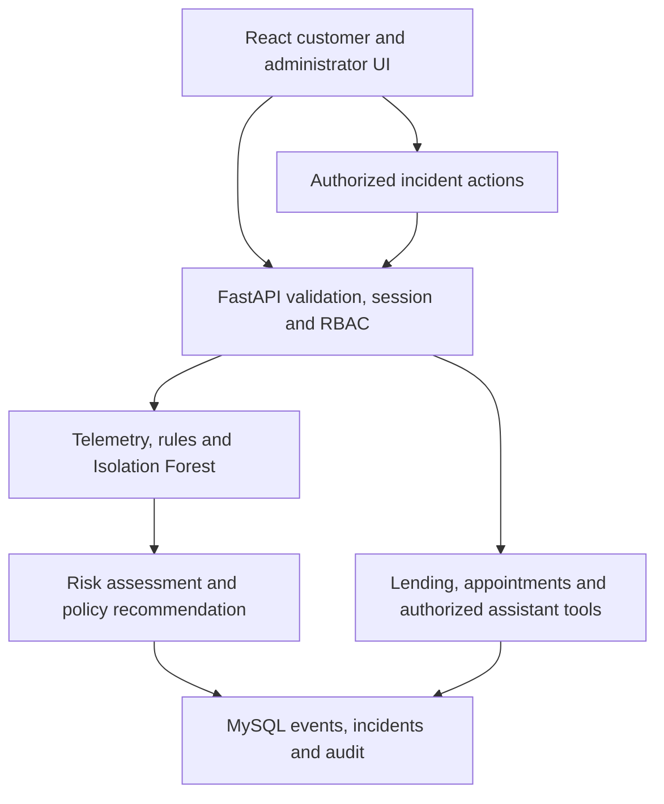
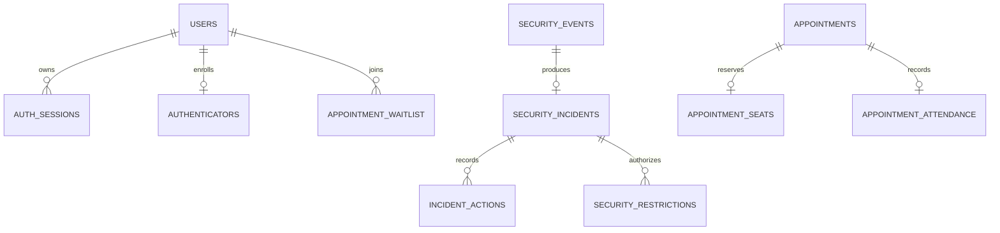

> Historical enhancement record. For the latest approved changes and chatbot-only asset placement, see [POLISH_REPORT.md](POLISH_REPORT.md) and [POLISH_VERIFICATION.md](POLISH_VERIFICATION.md).

# Enhancement release — 2026-10-16

This extends the previously delivered integrated project. It is an academic demo, not a bank or a production intrusion-prevention product.

## Implemented changes

- Two reference-based, transparent professional portraits generated with the built-in image tool. Originals were not overwritten. `frontend/public/agents/assistant-navy.png` is used on login and chat; `advisor-charcoal.png` appears on the customer dashboard. Prompts asked for identity-preserving, lightly cartoon-stylized portraits, navy/charcoal blazers, formal shirts, original facial characteristics, natural proportions, no text or props. No unrelated stock avatars are used.
- Banking-style two-column login, conversation bubbles and timestamps, source disclosures, real backend typing state, assistant failure states, customer welcome and application progress. Reusable AgentAvatar handles image failures. CSS animates the whole portrait subtly, never deforms the face, limits idle cycles and disables motion with prefers-reduced-motion. No new animation dependency.
- Read-only customer assistant tools answer explicit “my applications” and “my appointments” questions from authenticated user-scoped queries. General questions continue through existing RAG. These tools do not approve, submit or modify records.
- Persistent JWT sessions with server-side revocation, database-enforced single-active-session uniqueness and MySQL parent-row locking. Logout revokes the server session. Tokens issued before migration are rejected and require login.
- A competing credential-validated login is rejected. The existing session receives a 120-second server-controlled challenge, observed by visible-page polling every 10 seconds. Mutating domain operations pause while the challenge is pending; saved drafts and reads remain. Successful verification keeps the existing session; expiry revokes it. No competing session is automatically admitted. A later fresh login must authenticate again.
- Optional authenticator-app TOTP enrollment (six digits / SHA1 / 30 seconds), password confirmation before enrollment, code confirmation before activation, encrypted stored secrets, replay prevention, bounded enrollment verification attempts, login OTP enforcement and OTP-backed conflict challenges when enrolled. No SMS, email OTP or face recognition is implemented. Without enrollment, the challenge is explicitly password re-authentication, not MFA.
- Incidents link security events to deterministic policy recommendations and actual response status. Admins can triage, investigate, recommend, record notes, resolve, mark false positives, revoke a selected session, apply a temporary sensitive-operation restriction (1–60 minutes in API; 15 minutes in UI) and release restrictions. Version checks reject stale actions; terminal incidents only accept notes/releases. Actions are transactional and audited. ML never imposes an account restriction.
- Expanded URL signature evidence and behavior rules for repeated failures, distinct-account credential stuffing, enumeration, sensitive-access bursts and multi-signal flooding/bot suspicion. Generic API throttling supplements auth throttling. These are limited demo indicators, not comprehensive attack detection.
- Separate synthetic holdout evaluation for the existing Isolation Forest; no automatic training on live unverified events.
- Configurable appointment capacity, unique database seats, one customer per slot, idempotent booking keys, atomic rescheduling, cancellation, waitlist availability notices and administrator completed/missed attendance. Waitlist has no automatic booking or priority guarantee. Notifications are in-app; refresh to check availability. Saved legacy bookings are migrated to seat 0.

## Upgrade safely on Windows

Preserve your existing `backend/.env`, root `.env`, MySQL container and database. Copy updated source without deleting local configuration. Do not rerun FreshDocker mode in an existing configured directory.

From `aegislend`:

```powershell
.\scripts\setup.ps1 -Mode ExistingMySQL
.\scripts\migrate.ps1
.\scripts\test.ps1
.\scripts\start-backend.ps1
```

Second terminal:

```powershell
.\scripts\start-frontend.ps1
```

The migration chain is `0001 → 0002 → 0003 → 0004 → 0005 → 0006 → 0007`. Original migrations 0001–0003 are unchanged. Migration 0007 revokes pre-existing sessions to establish single-session uniqueness; account records and saved drafts are retained. Plan to sign in again after upgrading. Run forward upgrades; downgrading scheduling capacity is not a supported operational recovery strategy for populated databases.

Optional new settings in `backend/.env`:

```dotenv
API_RATE_LIMIT=180
APPOINTMENT_CAPACITY=1
```

API_RATE_LIMIT is requests per client key per 60 seconds; AUTH_RATE_LIMIT remains separate. For multi-worker deployments, use Redis for consistent throttling. Behavioral correlation remains per-process. Capacity reduction does not evict existing reservations.

Existing URLs: frontend http://localhost:5173 and backend http://127.0.0.1:8000/docs. If port 8000 is occupied, inspect it rather than terminating an unknown process:

```powershell
Get-NetTCPConnection -LocalPort 8000 -State Listen | Select-Object LocalAddress,LocalPort,OwningProcess
Get-Process -Id <OwningProcess>
```

If that process is your existing AegisLend backend, stop it in its original terminal before starting the updated backend. Do not reset MySQL to resolve a web-server port collision.

## Authenticator setup and recovery

Profile → Authenticator protection → confirm password → enter the secret manually into a trusted authenticator app → confirm the displayed code. The enrollment secret is shown only for setup, kept in React memory and sent with no-store headers. It is not included in audit metadata. Do not save screenshots of enrollment secrets.

The encrypted secret key is derived from JWT_SECRET with domain separation. Changing JWT_SECRET invalidates tokens and makes old authenticator secrets unreadable; plan operator-assisted re-enrollment when rotating it. There are no downloadable recovery codes. A trusted local operator must verify identity independently before using:

```powershell
Push-Location backend
..\.venv\Scripts\python.exe -m app.recover_authenticator --email synthetic-user@example.com --confirm-identity-verified
Pop-Location
```

This clears the factor, revokes all sessions and records an audit event. This CLI is never exposed to the assistant or through a public endpoint.

## Security category coverage and limits

| Category | Control / executed test family |
|---|---|
| SQL injection | ORM binding; controlled signature evidence test; no raw payload persistence |
| XSS | React text rendering; controlled signature test; no HTML answer rendering |
| Brute force | Auth limiter and repeated-failure rule tests |
| Credential stuffing | Distinct hashed account identities within a client window; synthetic multi-account test |
| Path traversal | No caller-selected filesystem document path; controlled URL signature test |
| Command injection | No user-controlled shell in request services; controlled URL signature test |
| Parameter tampering | Schema/transition validation and persisted category test |
| BOLA/IDOR | Ownership tests and scoped assistant tests |
| API abuse | Actual 429 throttling test |
| Account enumeration | Generic login errors, dummy password hash and behavioral test; registration status can still reveal account existence |
| Session abuse | Expiry, JWT validation, replay rejection, concurrent login and revoked-token tests |
| Privilege abuse | Role injection rejection, current database role, admin endpoint tests |
| Suspicious data access | Denial/burst correlation test |
| Automated flooding | Request frequency + repeated rate violations; actual 429 and persisted evidence tests |
| Bot abuse | Multiple behavior signals; synthetic test, not bot identification or fingerprinting |

Do not interpret this matrix as exhaustive coverage of all variants. Signatures observe URL/query input only; schema checks and safe APIs provide the actual prevention at data boundaries. No invasive fingerprinting/geolocation is collected. User-agent hashes are coarse metadata, not proof of a device identity.

## Remaining limitations

- Live MySQL locking/DDL, Redis, Windows/PowerShell/Docker and external LLM/CrewAI inference require environment verification. Browser installation failed, so no visual/browser success is claimed.
- Persistent challenge state works across workers, but event behavior windows and counters are per-process. There is no durable delivery queue or automatic replay of failed telemetry writes.
- Incident deduplication is one incident per event; cross-event incident grouping, retention automation and a full endpoint-sequence ML model are not implemented.
- TOTP is optional. Password-only users do not gain an independent authentication factor from re-entering their password. Challenge notifications use polling, not WebSocket push. Tokens stay in browser memory; refresh loses local login state. A rejected fresh login can initiate recovery of the abandoned session after its challenge deadline.
- No MPIN, seeded-bank-customer migration, account balances, repayment ledger, loan-document submission/verification or sanction-document generation is added. These were absent from the base and must not be implied by UI.
- Loan inputs remain self-reported synthetic estimates. No verified bank financial records or personalized credit recommendations are invented.
- Appointment waitlist notifications are in-app and manually refreshed. No SMS/email notifications, automatic waitlist promotion or configurable business hours are implemented.
- Agent animation uses subtle whole-image motion; no simulated facial deformation, blinking rig or video. Chat is session-local and does not persist conversation history.
- No claim of production readiness, penetration testing, regulatory compliance or real-world IDS accuracy.

## Updated component relationships




