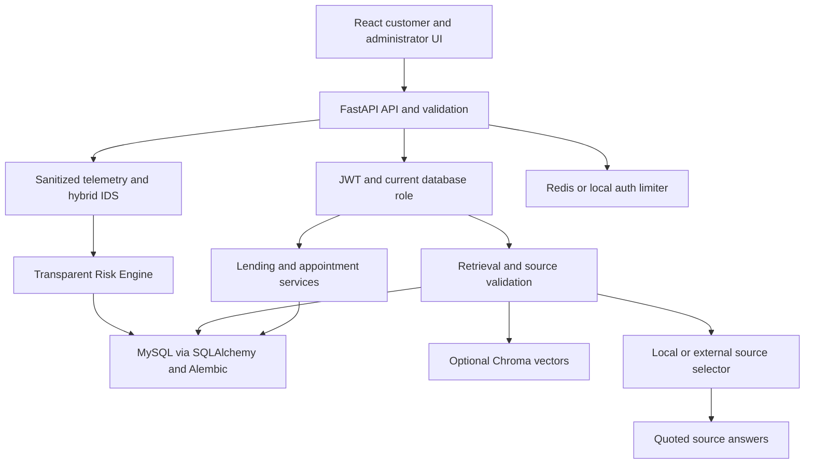
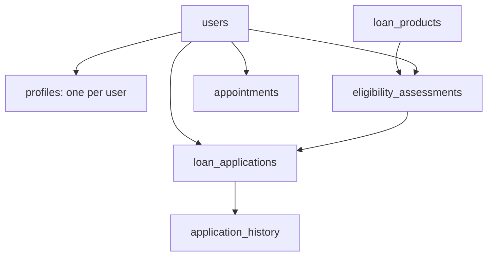
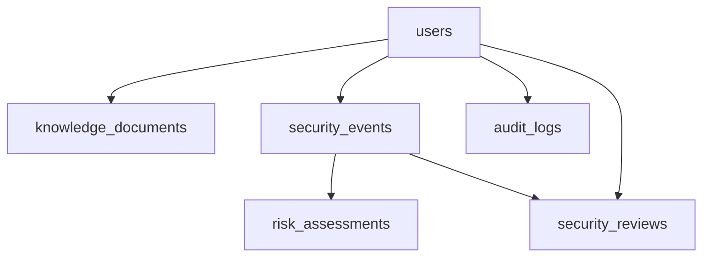
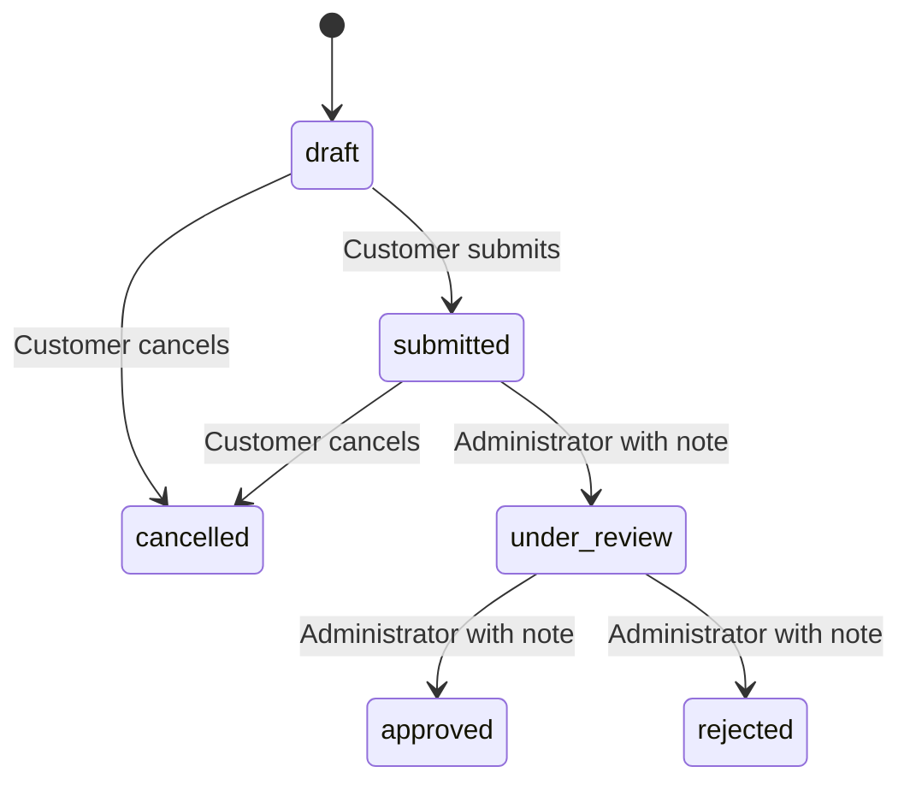

> This document describes the integrated baseline. Read [ENHANCEMENTS.md](ENHANCEMENTS.md) for the added session/OTP, incident, agent UI and appointment architecture, and [ENHANCEMENT_VERIFICATION.md](ENHANCEMENT_VERIFICATION.md) for current test evidence.

# Architecture, data, security and methodology

This document describes the implemented completion build. `ARCHITECTURE.md`, `PHASE2.md`, `VERIFICATION.md` and `history/README_PHASE2.md` retain earlier-phase evidence.

## Component architecture

The application is a modular monolith. Synchronous database/ML handlers run in FastAPI's thread pool. Sessions are per request, with transactions covering business mutations and their audit records. Telemetry writes are best effort and separately observable. AI has no path to a permission-changing operation or loan-decision function.

The frontend shares Axios through `api.ts` and typed domain contracts through `client.ts`. Reusable UI components provide feedback and loading states. React Router guards improve navigation; backend dependencies remain authoritative. In-memory JWT storage avoids persistence in localStorage but requires login after refresh. Logout clears the client copy, not all outstanding server-verifiable tokens.

## Database structure

Historical `0001_baseline` and `0002_users` are unchanged. `0003_integrated_domains` adds eleven domain tables. UUID identifiers are strings, money uses DECIMAL, and UTC timestamps are stored without timezone suffix in SQL and returned as UTC `Z` in domain responses. The MySQL connection sets session time_zone to +00:00. Browser display converts UTC into its local timezone.

| Table | Constraints / responsibility |
|---|---|
| system_metadata | Original baseline marker, preserved |
| users | Unique normalized email; customer/admin role constraint; Argon2 hash; active state |
| profiles | User primary/foreign key; editable display name and employment only |
| loan_products | Unique name; amount/tenure checks; decimal rates/income/DTI; active flag |
| eligibility_assessments | Owner and product FKs; input/result snapshots; no approval authority |
| loan_applications | Owner/product/assessment FKs; unique owner/request key; constrained status; optimistic version |
| application_history | Application/actor FKs; status/note/timestamp; stable lifecycle order for timestamp ties |
| appointments | Owner FK; unique nullable active_slot; original time retained after cancellation |
| knowledge_documents | Unique content hash; chunks/page metadata; index status/error; optional uploader FK |
| security_events | Category/severity/correlation/time indexes; numeric features and rule IDs, no raw bodies |
| risk_assessments | Unique event FK; score, severity, model output/version, explanation |
| audit_logs | Actor/event/target/correlation; allowlisted metadata; indexed event/time |
| security_reviews | Unique event review; human actor/action/note; no automatic enforcement |

New string foreign keys use utf8mb4_bin to match the existing users table. Slot uniqueness is enforced by SQL, not an in-memory availability check. Multiple cancelled appointments have NULL active_slot, allowing later rebooking. Existing product/assessment references are retained; products are deactivated instead of deleted through the UI.

## Lending methodology

For principal P, monthly rate r = annual percentage / 1200, and months n:

`EMI = P × r × (1+r)^n / ((1+r)^n − 1)`; when r=0, `EMI=P/n`.

Decimal arithmetic and half-up rounding produce two-decimal INR installments. Estimated total is rounded installment × months, not a lender's final amortization schedule. Inputs bound amount to 100,000,000, income/obligations to 10,000,000 and tenure to 1–360 months. Product-specific ranges and thresholds are separately checked. No fees, taxes, insurance or credit-bureau data are included.

Indicative eligibility requires product amount/tenure bounds, minimum income, regular employment (salaried or self-employed), and `(EMI + existing monthly obligations)/monthly income <= product.max_dti`. Failure yields explicit reasons, not an automatic application rejection. The immutable assessment snapshot remains interpretable if product settings later change.

A customer may not transition another user's application. Administrators cannot self-review. Each transition uses an UPDATE with expected status/version and writes history/audit in the same transaction. Creation uses a unique client request UUID and input fingerprint. Reusing a key with different inputs returns 409. A simultaneous duplicate can return 409 rather than create an orphan assessment.

## Appointments

The explicit academic policy is one shared advisor, hourly starts 09:00–16:00 UTC Monday–Friday, future times within 30 days. Incoming timestamps must contain a timezone and align exactly to the slot. Booking unique conflicts return 409. Only future booked appointments can be cancelled; ownership checks prevent cross-user cancellation. Administrators can view all appointments. Availability is advisory; the database constraint is authoritative under concurrency.

## RAG and bounded orchestration

1. Admin uploads UTF-8 TXT/Markdown or readable, unencrypted text PDF.
2. The request body is bounded before parsing; files are limited to 2 MiB, 100 PDF pages and 200,000 extracted characters.
3. Text is normalized into overlapping 800-character chunks, stepping by 600, with document/chunk/page metadata.
4. A normalized, nonnegative 512-feature hashing vector is the documented embedding implementation. It requires no network download or fitting. Simple plural normalization and English stop words help literal matching.
5. SQL retains authoritative document/chunk content; Chroma optionally stores/query-ranks identical embeddings via HTTP v2 with explicit 1-second connect / 3-second operation timeouts.
6. Local cosine similarity has a 0.12 minimum. Up to five candidates are source-validated; up to three are quoted. Obvious instruction-injection patterns are excluded. SQL validation prevents stale/deleted vector records from resurfacing removed text.
7. Default local source selection is deterministic. An optional OpenAI-compatible adapter or CrewAI task returns indices only. Unknown/malformed indices are rejected or fall back locally. Final answers are exact excerpts from selected sources, never arbitrary model-authored financial facts.

CrewAI is opt-in: a single bounded source-review agent, no tools/delegation/code execution, max_iter=2 and max_execution_time=20. It cannot access users, credentials, SQL sessions or review functions. The external HTTP adapter also has a timeout. The stages retrieve → validate_sources → extract are returned for observability. Optional package imports were verified; no external paid-model call was performed.

Hashing retrieval is lexical, not equivalent to a transformer encoder. Similarity and source presence do not prove factual truth; administrators control educational reference quality. OCR, malware scanning and robust hostile-PDF sandboxing are not supplied. Do not use private documents. Re-index after changing the embedding normalization/version; the vector collection name identifies its 512-dimensional family. External selection sends question/source snippets to the configured service only when explicitly enabled.

## Hybrid IDS and Risk Engine

Each process maintains a 60-second window keyed by an HMAC of the observed peer IP. Raw IPs are not persisted. Forwarding headers are not trusted by the supplied local server command. Stored numerical schema, in order: requests, auth_failures, denials, rate_violations. Counters are per process; a distributed event store would be required for production correlation.

Rule contributions: unknown_account 15; auth_failure 10; unauthorized 25; resource_access_denied 45; privilege_escalation 65; suspicious_request 65; rate_limit 40; controlled demo_probe 35. Additional contributions: repeated failures ≥ configured threshold +35; repeated rate violations ≥3 +20; request burst ≥ configured threshold +25. URL patterns include decoded UNION SELECT, script tags, traversal and OR 1=1. These are representative detection rules, not a WAF or exploit-prevention guarantee.

Isolation Forest trains on 512 synthetic windows generated with NumPy seed 42, a pandas feature frame, log1p preprocessing, 100 trees, contamination 0.03 and random_state=42. It returns decision_function score and a class based on the configured threshold (default 0). Negative/default-below-threshold scores indicate anomalies. Version, feature schema, sample count, seed, training timestamp, sklearn version and artifact checksum accompany the trusted local joblib file. Missing/incompatible/corrupt artifacts degrade to rule-only scoring.

An anomaly adds 25 to the risk score. The sum is capped at 100; bands are low <30, medium 30–59, high 60–79, critical ≥80. Every stored event/risk has a correlation ID and explanation. This is security telemetry, entirely separate from credit/eligibility decisions. Synthetic tests establish repeatability, not precision/recall on real attacks.

Security Center uses backend counts, grouped severity, seven-day failed-login counts, recent model/risk records and paginated events. Its only response actions are human acknowledgement or escalation, once per event, with a note. No auto-blocking, role changes or AI-driven enforcement occurs.

## Security and threat model

| Threat | Implemented control | Residual limitation |
|---|---|---|
| Password disclosure | Argon2id, SecretStr, response schemas, safe validation errors | No MFA/recovery/email verification |
| Token tampering / stale privilege | HS256 allowlist; required claims; signature/expiry/issuer/audience checks; current user role/active state | No per-token denylist; secure TLS hosting is not provided |
| Privilege escalation / IDOR | Server dependencies, UUID validation, ownership filters, registration extra-field rejection | Local operator privileges remain a trusted boundary |
| Brute-force auth | Redis rate limiting or bounded one-process fallback; dummy verification for unknown users | IP sharing/false positives; distributed IDS counters not implemented |
| SQL injection | Bound SQLAlchemy expressions; fixed health SQL; no interpolated user SQL | No penetration test or complete WAF claim |
| Double booking / stale decisions | Unique active slot; transaction rollback; optimistic status/version predicates | MySQL concurrency still needs actual execution verification |
| Uploaded document attacks | Admin-only, bounded body/type/signature/text/pages, no saved attacker-chosen paths | No antivirus/OCR sandbox; do not ingest adversarial files |
| Prompt injection | Sources treated as data; no tools; source-index selection; final verbatim excerpts | Malicious source claims can still be quoted; source vetting required |
| Secret-bearing logs | No raw auth bodies/tokens/SQL URLs, generated correlation IDs, explicit audit metadata | Local host/process compromise is outside this demo boundary |
| Lost telemetry | Observable failures and X-Telemetry-Status, safe retry delay; no fake persisted counts | Best-effort events may be lost during outages; no durable queue |
| Model artifact poisoning | Trusted local path, checksum/schema/version validation; uploads cannot write model files | Joblib is unsafe for untrusted artifacts; host access must be secured |

Domain mutation audits share their transaction. Authentication and request detection telemetry is best effort: failures increment degraded indicators and do not turn a successful customer operation into a false database failure. Audit records are not append-only/WORM protected against a database administrator.

## Source responsibilities

| Source | Responsibility |
|---|---|
| backend/app/main.py | App factory, CORS, error handling, correlation/telemetry middleware, health |
| config.py / db.py | Environment validation, engine/session lifecycle and UTC connection |
| auth.py / security.py | Login/registration, current-user/admin dependencies, hashing/JWT |
| models.py / domain_models.py | Preserved users/metadata and new domain entities |
| schemas.py / domain_routes.py | Typed domain validation, protected endpoints and transactions |
| lending.py | Decimal EMI and deterministic explainable rules |
| rag.py | Extraction, chunking, embeddings, timed Chroma adapter, bounded selectors |
| ids.py | Model lifecycle, rules, Risk Engine, rate limiter and sanitized telemetry |
| body_limit.py | Pre-parser JSON/multipart request byte limits |
| seed.py / bootstrap.py / manage.py / train_ids.py | Explicit local demo/operator workflows |
| backend/alembic/versions | Immutable ordered schema history |
| frontend/src/App.tsx / Foundation.tsx | Integrated routing/navigation and preserved health dashboard |
| session.tsx / api.ts / client.ts | In-memory session and typed HTTP boundary |
| customer.tsx / admin.tsx / ui.tsx | Customer/admin workflows and reusable feedback components |
| scripts/*.ps1 | Windows setup, migration, seed, test and host startup |
| scripts/build_release.py | Source-only archive and known-secret exclusion check |
| frontend/e2e/smoke.cjs | Isolated browser workflow runner (unverified here) |
